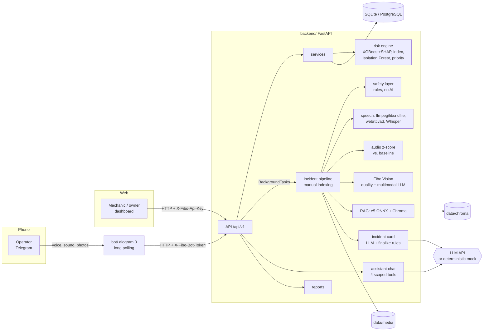
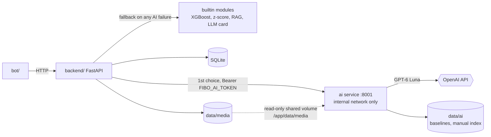

# Fibo — predictive maintenance for small workshops without sensors
ДЛЯ ЖЮРИ ЕСЛИ НЕТУ ВРЕМЕНИ НА ВВЕДЕНИЕ СТАНКОВ И ТД rahalaa313@gmail.com лоигн: Ra280212 парооь
Fibo estimates how likely each machine in a small workshop (5–30 machines, Shymkent, Kazakhstan) is
to fail, explains why, and ranks maintenance work by expected loss in tenge — **without sensors**.
Data comes from an ordinary phone: operators talk to a **Telegram bot** (voice in Russian or Kazakh,
machine sounds, photos of tools and controller screens), mechanics use the **web dashboard** (built by
another teammate against this API).

| Module | What it does |
| --- | --- |
| **Fibo Machine** | Machine registry, readings, incidents; calibrated failure probability (XGBoost + SHAP), risk index, anomaly detection (Isolation Forest), machine-sound check against its own baseline, priority in ₸, what-if |
| **Fibo Vision** | Photo quality check, tool/part photo vs. reference photo, reading numbers from CNC/controller displays (confirmed by a person) |
| **Fibo Reports** | Downtime, losses in ₸, MTBF, top causes, CSV export |
| **Fibo Assistant** | Telegram bot, speech → text, symptom extraction, safety layer, manual search with page citations (RAG), AI chat with tools |

Every workshop has an **industry profile** (metalworking, bakery, confectionery, sewing, dairy) —
configuration in YAML, not code: equipment catalog, risk weights, valid ranges, keywords, prompts.

> **Honesty note.** The demo workshops created by `python -m app.db.seed` are synthetic: every row has
> `is_demo = true` and the names say "демо-данные". No synthetic data is presented as real.

---

## Architecture



**How an incident flows:** voice message → bot uploads (`/ingest/voice`, answer 202) → background
pipeline: convert → VAD (speech or machine sound) → **safety check (saved immediately)** → transcript →
symptom extraction → manual search → card (LLM) → rules (only retrieved pages, safety forces CRITICAL,
measured levels are a floor) → incident OPEN → risk recomputed → bot polls and sends the card with
buttons *Resolved / Call mechanic / Manual page*.

Code tour for teammates: [docs/walkthrough.md](docs/walkthrough.md). Every design choice and deviation:
[docs/decisions.md](docs/decisions.md).

---

## AI service (sidecar) and automatic fallback

The web assistant chat connects directly to the model API. Set `FIBO_LLM_BASE_URL`,
`FIBO_LLM_API_KEY`, and `FIBO_LLM_MODEL` in `backend/.env`, then restart the backend.
`GET /api/v1/ai/assistant/status` reports configuration readiness without returning credentials.
Chat requests default to `mode: "live"`, independently of the incident pipeline's `FIBO_AI_MODE`.
Provider failures return an error with a retry action; they never silently return a canned answer.
The chat's **Расчёты без AI** action explicitly selects `mode: "offline"` for deterministic reports.
General explanations use the model; workshop facts come from seven tools scoped to that workshop.

`FIBO_LLM_REASONING_EFFORT=auto` omits sampling parameters for API compatibility. For GPT-6 Luna
or Sol with Chat Completions function calling, explicitly use `none`, as required by the
[model documentation](https://developers.openai.com/api/docs/models/gpt-6-luna).



| Mode | How to run | What happens |
| --- | --- | --- |
| `FIBO_AI_PROVIDER=builtin` (default) | `docker compose up --build` | The backend's own modules only — the behaviour described below |
| `FIBO_AI_PROVIDER=sidecar` | `docker compose --profile ai up --build` + `FIBO_AI_TOKEN`/`AI_SERVICE_TOKEN` | Incident card, risk probability, panel values, audio baseline and manual index come from the AI service first; any failure → builtin, tagged in the incident's `degraded` |

The backend stays the source of truth: it stores everything, re-checks safety on the caption and on the
AI's transcript, uses the measured sound level as a floor, keeps only manual pages the AI cited, and
renders the plain-text card. Unusable input (blurry photo, silent audio, speech not recognised) gives a
"redo it" card instead of a guess. `/api/v1/health` shows `ai_provider`, `ai_sidecar` and `ai_models`.

Variables: `FIBO_AI_PROVIDER`, `FIBO_AI_URL` (`http://ai:8001`), `FIBO_AI_TOKEN`, `FIBO_AI_TIMEOUT_S`,
`FIBO_AI_SHARED_DIR` (backend); `AI_SERVICE_TOKEN`, `OPENAI_API_KEY`, `LLM_MODEL`, `LLM_VISION_MODEL`,
`LLM_REASONING_EFFORT`, `AI_STUB_MODE` (AI service) — see `.env.example`.

The AI service source is in `ai/fibo_ai/` (D80); the backend's adapters follow its real schemas and a
contract test validates requests and sample answers against them (D81). **Not in this repository:** its
Dockerfile, dependency list, tests and trained artifacts. The sidecar mode was tested only against a mocked
AI service — never end-to-end or live.

---

## AI components and their logic

| Component | How it works | Fallback / guard |
| --- | --- | --- |
| **Failure probability** | XGBoost on AI4I 2020 (8 features), isotonic calibration on the validation split, SHAP TreeExplainer for the top factors | No artifacts → index-only mode; model not applicable to food/sewing profiles |
| **Risk index** | Weighted mean of available signals (model, sound, photo, overdue maintenance, recent incidents), weights per profile | Missing signals are left out, not counted as zero |
| **Priority (₸)** | risk index × criticality weight × downtime cost/h × repair hours (+ batch value for food) | — |
| **Anomalies** | Isolation Forest per machine on its own readings (≥ 20) | "insufficient history" otherwise |
| **Machine sound** | 14 explainable features (8 mel bands, loudness, spectral centre, roll-off, flatness, ZCR, crest factor) on 1 s windows; z-score vs. the machine's own baseline | Measured level cannot be lowered by the LLM |
| **Speech** | ffmpeg (or libsndfile) → 16 kHz; webrtcvad decides speech vs. machine sound; Whisper-compatible API | Mock transcripts offline |
| **Safety layer** | Regex rules on word stems, Russian + Kazakh + profile phrases (smoke, sparks, burning smell, shock…); **not AI**; saved before any LLM call | Forces CRITICAL and the stop text, even if AI fails |
| **Vision** | Laplacian sharpness + brightness check; multimodal LLM compares photo with reference (level + confidence, never wear %) | Bad photo → "retake" without AI |
| **Panel OCR** | Multimodal LLM reads the display; code keeps only profile fields within valid ranges | **Never saved** until a person confirms |
| **Manual search (RAG)** | PyMuPDF → per-page chunks (800/150) → multilingual-e5-small (ONNX) → Chroma, filtered by machine | Card may cite only retrieved pages; "not found" stated |
| **Assistant chat** | Function calling with 4 read-only tools scoped to the workshop, ≤ 4 rounds | Answers only from tool results |

Every external AI call goes through one interface with a **deterministic mock** (`FIBO_AI_MODE=mock`):
the whole system, tests and demo run offline. The live client has timeouts, 2 retries (1 s, 3 s) only for
timeouts/429/5xx, Pydantic-validated JSON with one repair attempt.

---

## Metrics

**Failure-probability model** (`backend/ml/artifacts/metrics.json`, AI4I 2020, 10 000 rows, 3.4 % failures,
stratified 60/20/20, seed 42, model `xgb-ai4i-dc6630cd`), on the untouched test split (2 000 rows):

| ROC-AUC | PR-AUC | Brier raw → calibrated | Threshold (best F1 on validation) | Precision | Recall | Confusion (tn/fp/fn/tp) |
| --- | --- | --- | --- | --- | --- | --- |
| 0.976 | 0.735 | 0.0205 → 0.0139 | 0.875 | 0.84 | 0.63 | 1924 / 8 / 25 / 43 |

Accuracy is deliberately not reported: predicting "never fails" would already be 96.6 % accurate.
The failure-mode columns (TWF, HDF, PWF, OSF, RNF) and ids are excluded — they leak the target (tested).

**Machine-sound method** (`backend/ml/artifacts/audio_metrics.json`, DCASE 2020 Task 2 dev set, *slider*,
60 baseline clips per machine id, 60 normal + 60–99 anomalous test clips):

| id_00 | id_02 | id_04 | id_06 | **mean ROC-AUC** |
| --- | --- | --- | --- | --- |
| 0.82 | 0.68 | 0.61 | 0.42 | **0.63** |

Honest reading: few false alarms (95–100 % of normal clips below z = 2), but the subtle slider anomalies
are mostly missed; the method targets clear changes such as knocks, bearing noise and rubbing (synthetic
tests: z = 8–14). See decisions D46.

**AI service models** (copied from `ai/README_ML.md`, generated by the AI service's own scripts — not
reproduced here): risk LightGBM on AI4I ROC-AUC 0.9748, PR-AUC 0.8653; machine sound (DCASE fan,
`mfcc_baseline`) mean ROC-AUC 0.5484, z thresholds attention 6.094σ / critical 16.092σ.
**Not validated:** AI service latency budgets, PatchCore part-defect detection (not used in the demo),
GPT-6 Luna card quality, Kazakh texts of the new AI cards (D77) and of the safety keywords (D68).

---

## Run it

### Option A — Docker (backend + bot)

Requires Docker with Compose v2.

```bash
cp .env.example .env
```

Edit `.env`: set `FIBO_TELEGRAM_BOT_TOKEN` (from @BotFather) and a long random `FIBO_BOT_SHARED_SECRET`.

```bash
docker compose up --build
```

Then, in a second terminal, create the demo data (bot invite codes `DEMO01`, `DEMO02`):

```bash
docker compose exec backend python -m app.db.seed
```

API: http://localhost:8000/docs · health: http://localhost:8000/api/v1/health.
Set `FIBO_PRELOAD_EMBEDDINGS=true` in `.env` to bake the e5 model into the image (offline manual search).

### Option B — locally without Docker (Python 3.11)

Backend:

```bash
cd backend
python3.11 -m venv .venv
source .venv/bin/activate
pip install -r requirements-dev.txt
cp ../.env.example ../.env
alembic upgrade head
python -m app.db.seed
uvicorn app.main:app --reload
```

Bot (second terminal, needs `FIBO_TELEGRAM_BOT_TOKEN` in `.env`):

```bash
cd bot
python3.11 -m venv .venv
source .venv/bin/activate
pip install -r requirements-dev.txt
python -m bot.main
```

In Telegram: `/start` → invite code `DEMO01` → role → language.
Without ffmpeg, OGG/WAV/MP3 still work (libsndfile). On macOS, xgboost needs OpenMP (`brew install libomp`).

### Mock vs. live AI

`FIBO_AI_MODE=mock` (default): no network, deterministic answers. For real models set in `.env`:

```bash
FIBO_AI_MODE=live
FIBO_LLM_BASE_URL=https://api.openai.com/v1
FIBO_LLM_API_KEY=...
FIBO_LLM_MODEL=...
FIBO_LLM_VISION_MODEL=...
FIBO_WHISPER_MODEL=...
```

Any OpenAI-compatible provider works. `FIBO_SPEECH_BACKEND=local` uses faster-whisper (install it separately).

### Train and evaluate

```bash
cd backend
python -m ml.train_risk_model --data path/to/ai4i2020.csv
python -m ml.eval_audio_mimii --data path/to/dcase/slider
```

### Tests and lint

```bash
cd backend && pytest && ruff check .
```

```bash
cd bot && pytest && ruff check .
```

---

## Documented assumptions (full list: docs/decisions.md)

- **load % → torque**: `torque = load_pct / 100 × nominal torque of the profile (60 N·m)` — approximation.
- **Air temperature** is not measured: profile default 298 K. Missing process temperature: air + 10 K.
- **Machine class L/M/H** from criticality 1/2/3 — approximation.
- **Tool wear** from the operating-hours counter since the last tool change, capped at the training maximum (253 min).
- Values outside the AI4I training ranges are allowed but flagged in the score's `assumptions`.
- **Priority** uses the risk index instead of P(failure), so machines without the model are ranked too.
- **Overdue maintenance** uses calendar hours since the last maintenance.
- **Ongoing downtime** = time since an unresolved incident was reported (not proof the machine stopped).
- **MTBF** uses the operating-hours counter, else calendar time (marked in the report).
- Kazakh texts and safety keywords are drafts to be checked by a native speaker.

## API overview

`/api/v1`: `health`, `profiles`, `workshops`, `users`, `bot/*`, `machines` (+ `summary`, `readings`,
`baselines`, `manuals`, `risk-history`), `readings` (+ `panel-photo`), `ingest/voice|audio|photo`,
`incidents` (+ `resolve`, `retry`, `escalate`, `manual-excerpts`), `media/{path}`, `risk-scores`
(`recompute`, `ranking`, `what-if`), `reports` (`summary`, `export.csv`), `ai/assistant/chat`.
All errors share one shape: `{"error": {"code", "message", "details", "request_id"}}`.
Auth: bot → `X-Fibo-Bot-Token`; browser → owner session from `/auth/register` or `/auth/login` (Bearer token and HttpOnly cookie). Browser data requests are scoped to the owner’s workshop. `X-Fibo-Api-Key` is reserved for trusted integrations and is not injected by the public web proxy.

For local web + API development after installing dependencies, run `./scripts/dev.sh` from the repository root. It applies migrations and starts the API on port 8000 and the web app on port 5174. The offline assistant uses labelled deterministic tools; live language-model answers require the configured API credentials.

## Datasets, models and licences

| Resource | Use | Licence |
| --- | --- | --- |
| AI4I 2020 Predictive Maintenance (UCI, id 601) | Training the failure model | CC BY 4.0 |
| DCASE 2020 Task 2 development set (MIMII-based), *slider* subset | Evaluating the audio method only; not committed | CC BY-NC-SA 4.0 |
| intfloat/multilingual-e5-small (official int8 ONNX export) | Manual search embeddings | MIT |

Code: written for this hackathon. Libraries: see `backend/requirements.txt`, `bot/requirements.txt`.

## Team and roles

| Name | Role |
| --- | --- |
| *(fill in)* | Backend, ML, bot |
| *(fill in)* | Web dashboard |
| *(fill in)* | Product, demo |
